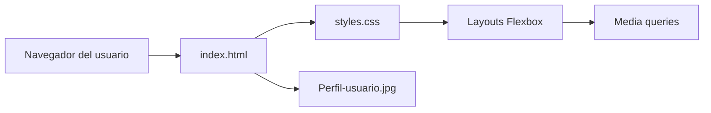
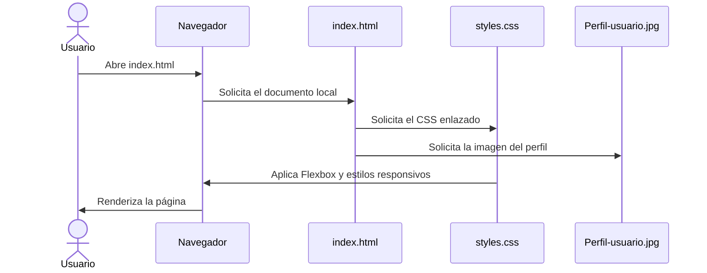

# Maquetación con Flexbox


## Descripción y propósito

Proyecto web estático destinado a practicar maquetación con CSS Flexbox. La página muestra ejemplos de cabecera, navegación, barra lateral, contenido principal, contenido complementario, galería, tarjetas, perfil de usuario, calificación con estrellas y pie de página, junto con una lista de ejercicios para resolver o modificar.

Está orientado a estudiantes, evaluadores académicos y personas que estén aprendiendo los fundamentos de layouts responsivos con Flexbox.

## Tabla de contenidos

- [Características principales](#características-principales)
- [Arquitectura](#arquitectura)
- [Stack tecnológico](#stack-tecnológico)
- [Estructura del proyecto](#estructura-del-proyecto)
- [Requisitos previos](#requisitos-previos)
- [Instalación y configuración](#instalación-y-configuración)
- [Uso](#uso)
- [Testing](#testing)
- [Despliegue](#despliegue)
- [Contribución](#contribución)
- [Licencia](#licencia)
- [Autores y contacto](#autores-y-contacto)
- [Información pendiente](#información-pendiente)

## Características principales

- Maquetación de página completa mediante CSS Flexbox.
- Diseño responsivo con ajustes para anchos inferiores a 768 px y 480 px.
- Ejemplos independientes de navegación, sidebar, galería, tarjetas, perfil y footer.
- Calificación visual con cinco estrellas y representación parcial de la puntuación.
- Propuesta de ejercicios práctica sobre distribución, crecimiento, alineación y diseño móvil.
- Sin dependencias externas ni proceso de compilación.

## Arquitectura

### Visión general

El proyecto sigue una arquitectura estática de tres archivos principales: HTML para la estructura, CSS para presentación y distribución, y una imagen local para el componente de perfil. No existen capa de servidor, base de datos ni servicios externos.

Los principios visuales principales son:

- Un único archivo HTML como entrada del sitio.
- Una única hoja de estilos externa que define todos los layouts.
- Uso exclusivo de Flexbox para los contenedores de maquetación.
- Adaptación progresiva mediante media queries.

### Componentes



### Flujo principal



### Módulos visuales

- **Cabecera y navegación:** contenido de presentación y menú horizontal.
- **Contenido principal:** área central, galería y conjunto de tarjetas.
- **Sidebar y aside:** áreas laterales independientes.
- **Perfil:** imagen circular y información textual.
- **Footer:** texto y enlaces distribuidos mediante Flexbox.
- **Ejercicios y desafíos:** enunciados de práctica incluidos en la página.
- **Calificación:** representación visual de una puntuación del 90 %.

### Modelo de datos

El proyecto no almacena datos ni utiliza entidades persistentes. Los contenidos se encuentran directamente en `index.html` y el único recurso binario es `Perfil-usuario.jpg`.

### Decisiones técnicas clave

| Decisión | Justificación |
|---|---|
| HTML y CSS puros | Permite estudiar Flexbox sin la abstracción de frameworks o herramientas de compilación. |
| Flexbox como única técnica de layout | Hace explícito el objetivo académico de la práctica. |
| CSS externo | Separa la estructura del documento de sus estilos. |
| Archivo de imagen local | Evita una dependencia de un servicio externo para mostrar el perfil. |

### Consideraciones

- **Seguridad:** al no tener servidor, formularios ni entradas dinámicas, no se requieren variables de entorno ni autenticación.
- **Escalabilidad:** la página está pensada como ejercicio académico y no como aplicación de producción.
- **Rendimiento:** consta de un documento HTML, una hoja de estilos y una única imagen local, por lo que no requiere proceso de compilación ni gestión de paquetes.

## Stack tecnológico

| Tecnología | Versión | Rol |
|---|---|---|
| HTML5 | Especificación vigente del navegador | Estructura semántica del documento |
| CSS3 | Especificación vigente del navegador | Layouts Flexbox, estilos y diseño responsivo |
| Navegador web moderno | No especificada | Ejecución y renderizado |

## Estructura del proyecto

```text
.
├── index.html          # Documento HTML y contenido de la práctica
├── styles.css          # Estilos y layouts Flexbox
├── Perfil-usuario.jpg  # Imagen utilizada por el componente de perfil
└── README.md           # Documentación del proyecto
```

## Requisitos previos

- Navegador web moderno.
- Editor de código opcional, recomendado para modificar los ejercicios.
- Git únicamente si se desea clonar el repositorio desde una terminal.

## Instalación y configuración

### Clonar el repositorio

```bash
git clone https://github.com/Campriet03/Maquetaci-n-con-flex.git
cd Maquetaci-n-con-flex
```

### Ejecutar localmente

No se requiere instalación de paquetes ni configuración adicional. Abra `index.html` directamente desde el explorador de archivos o arrastre el archivo al navegador.

Para servir el proyecto mediante la extensión Live Server de Visual Studio Code:

1. Abra la carpeta del proyecto en Visual Studio Code.
2. Inicie un servidor local con Live Server.
3. Abra la URL que proporcione la extensión.

## Variables de entorno

El proyecto no utiliza variables de entorno.

## Uso

1. Abra `index.html`.
2. Modifique `styles.css` para realizar los ejercicios definidos en la página.
3. Recargue el navegador para revisar los cambios.
4. Redimensione la ventana para comprobar los layouts responsivos.

Los principales puntos de Flexbox utilizados se encuentran bajo los comentarios de `styles.css`, entre ellos `.contenedor-principal`, `.contenido-principal`, `.sidebar`, `.galeria`, `.tarjetas` y `.footer`.

## Testing

No existe suite automatizada de pruebas ni herramienta de linting configurada. La validación recomendada es manual:

- Abrir el sitio con un navegador de escritorio.
- Comprobar los diferentes bloques Flexbox.
- Redimensionar la ventana por debajo de 768 px y 480 px.
- Verificar que las imágenes y estilos carguen sin errores en la consola.
- Comprobar que la apariencia y el orden sean los esperados.

## Despliegue

Al ser un sitio estático, puede desplegarse mediante cualquier servicio de alojamiento de archivos estáticos que publique `index.html`, `styles.css` y `Perfil-usuario.jpg` desde la raíz del repositorio.

## Roadmap

- Completar todos los ejercicios incluidos en `index.html`.
- Verificar la adaptación completa del layout en dispositivos móviles.
- Resolver el desafío de calificación parcial con estrellas.
- Agregar validación HTML, CSS y visual automatizada.

## Contribución

### Flujo de trabajo

```bash
git checkout -b feature/nombre-del-cambio
git add index.html styles.css Perfil-usuario.jpg
git commit -m "Implementa el ejercicio de Flexbox"
git push origin feature/nombre-del-cambio
```

Después cree una solicitud de cambios (pull request) contra `main`.

### Convenciones básicas

- Modifique preferentemente `styles.css` para los ejercicios de maquetación.
- Mantenga la estructura existente de `index.html` salvo que el ejercicio lo requiera.
- Evite CSS Grid y otras técnicas de layout que contradigan el objetivo de la práctica.
- Describa en el commit qué ejercicio o componente modificó.
- Incluya una captura o descripción del resultado visual en la solicitud de cambios cuando corresponda.

## Licencia

<!-- TODO: completar -->

## Autores y contacto

- Camilo Prieto, identificado en el contenido de la página.
- <!-- TODO: completar correo de contacto público y perfil de GitHub si difiere del repositorio -->
